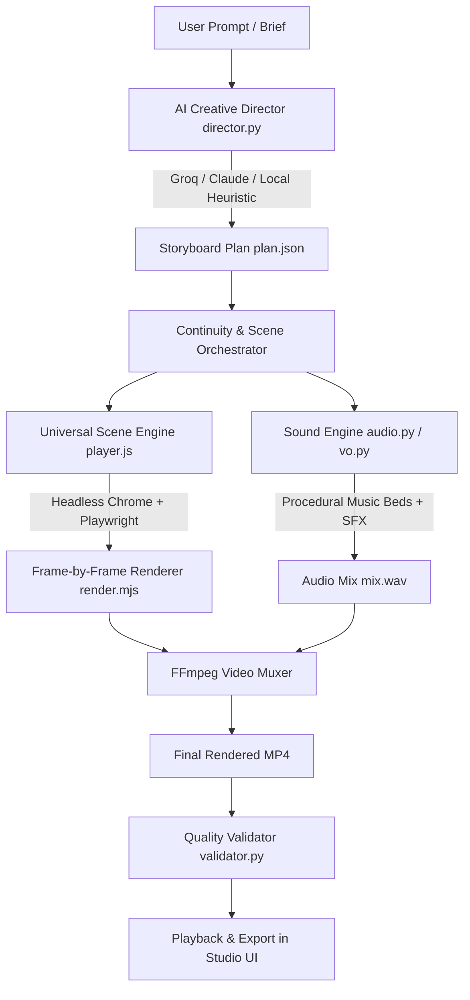

# Universal Animated Video Generator 🎬✨

An AI-powered creative animation studio that transforms arbitrary text prompts, stories, concepts, or scripts into fully animated, rendered, and audio-synchronized MP4 videos.

---

## 🌟 Highlights & Capabilities

- **Any Animation Genre**: Not limited to product marketing. Supports **Storytelling & Entertainment**, **Educational & Explainers**, **Cinematic & Creative Sequences**, **Social Media (Reels/TikTok/Shorts)**, and **Specialized Data & Technical Visualizations**.
- **Universal Scene Engine**:
  - `story`: Multi-layer animated environments (Martian canyons, deep space nebulae, enchanted forests, cyberpunk alleys), procedural atmospheric particles (dust, stars, embers, spores, fireflies), character animation (robots with glowing optic sensors, adventurers), and synchronized subtitle cards.
  - `motion`: High-end obsidian motion graphics powered by built-in templates (`16-line-growth`, `10-candlestick`, `13-compare-bars`).
  - `cinematic`: Anamorphic letterbox bars, chromatic lens flare sweeps, 3D perspective camera drift, and bold typography.
  - `whiteboard`: Animated hand-drawn diagrams, connecting arrows, concept nodes, and highlighter strokes.
  - `kinetic`: Fast-paced kinetic typography with scale pop and keyword accent pills.
  - `ui`, `cards`, `terminal`, `chips`, `text`, `hero`, `logo`: Full backward compatibility for SaaS demos and product videos.
- **Universal Sound Engine (`audio.py`)**:
  - Algorithmic DSP music bed generator supporting multiple moods: `cinematic` (lush ambient strings & sub drone), `lofi` (mellow electric piano), `suspense` (tense dark drone & pulse), `synthwave`, `playful`, `corporate`, or `silent`.
  - Rich procedural SFX kit: `whoosh`, `swish`, `riser`, `boom`, `pop`, `ding`, `ping`, `sparkle`, `laser`, `impact`, `glitch`, `shimmer`.
- **Character & Visual Continuity**: Tracks characters, environments, lighting, and color palettes across scenes for coherent story progression.
- **Interactive Web Studio UI (`studio/`)**: Visual creative brief, prompt preset library, interactive storyboard editor, SSE real-time render stream, integrated video player, and Quality Validation dashboard.
- **Automated Quality Validation (`validator.py`)**: Verifies video codecs (H.264), audio channels (AAC), duration adherence, frame rates, and detects unintended black frames.

---

## 🚀 Quick Start

### 1. Launch the Visual Studio (Browser UI)

```bash
npm start
# Or: node studio/server.mjs
```
Open **`http://127.0.0.1:4350`** in your browser.

- Type any prompt (e.g., *"A 45-second animated story about a lonely robot discovering a garden on Mars"*).
- Click **Plan Storyboard** to generate the scene sequence.
- Edit scene durations, visual directions, or reorder cards.
- Click **Render Video** to watch live progress and stream the finished video!

### 2. Run from the Command Line (CLI)

Generate and render an animated video end-to-end:

```bash
# Storytelling Narrative
python animate.py "A lonely robot discovering a garden on Mars" --duration 45 --style cinematic

# Educational Whiteboard Explainer
python animate.py "Explain quantum superposition and entanglement" --category educational --style whiteboard --duration 30

# Social Media Kinetic Reel (9:16)
python animate.py "Stop scrolling. 3 daily habits to double your focus" --category social --format 9:16 --duration 15

# Specialized Financial / Data Visualization
python animate.py "Cryptocurrency market shift and trading volume comparison" --category specialized --style motion_graphics --duration 20
```

---

## 🛠 Architecture & Pipeline



---

## 🧪 Running Automated Tests

Run the test suite verifying prompt understanding, category detection, continuity tracking, audio DSP synthesis, and validation:

```bash
# Core generator test suite (17 tests)
python test/test_generator.py

# NullMotion integration & adapter contract suite (determinism, seek order, schemas, formats, smoke renders)
python test/test_motion.py
```

---

## 📊 Motion Templates (NullMotion Integration)

The launch-video engine integrates a verified subset of the NullMotion graphics library into a deterministic, data-driven contract driven by `engine/motion/adapter.js`. All motion scenes are pure functions of time $t$, with paused timelines driven via `tl.seek(t, false)`.

### Implemented Templates & Data Schemas

| Template ID | Status | Description | Required Fields | Optional Fields |
| :--- | :--- | :--- | :--- | :--- |
| `16-line-growth` | **implemented** | Smooth growing cubic curve with data points & marker badges | *(none)* | `points` (array), `markers` (array), `title` (string) |
| `13-compare-bars` | **implemented** | Dynamic comparative bars with auto multiplier calculation | `bars` (array of 2: `{ label, value }`) | `unit` (string) |
| `10-candlestick` | **implemented** | Financial candlestick price action with wicks & readout | *(none)* | `title` (string), `metric` (string), `candles` (array) |
| `14-leaderboard` | **implemented** | Ranked benchmark leaderboard with progress bars | `items` (array: `{ rank, name, score }`) | `title` (string) |
| `01-cta-pill` | **implemented** | Obsidian glass call-to-action pill with glint sweep | `label` (string) | `subcopy` (string) |
| `02-three-step` | **implemented** | Sequential three-step cards with numbered badges | `steps` (array of 3: `{ step, title, desc }`) | *(none)* |
| `06-notification` | **implemented** | Frosted glass system notification banner | `title` (string), `body` (string) | `time` (string) |
| `18-cta-click` | **implemented** | Interactive button with cursor entrance and click wave | `label` (string) | *(none)* |
| `22-kinetic-headline` | **implemented** | Kinetic typography headline with numeric ticker counter | `words` (array of strings) | `counter` (string) |

### Plan Format for Motion Scenes

```json
{
  "type": "motion",
  "template": "13-compare-bars",
  "text": "Comparative Performance",
  "data": {
    "bars": [
      { "label": "Baseline", "value": 100 },
      { "label": "Benchmark", "value": 350 }
    ],
    "unit": " pts"
  }
}
```

---

## 🧩 Adding a Template

To add a new motion template from NullMotion or custom graphics to the engine:

### 1. Adapter Contract
Add an adapter to [engine/motion/adapter.js](file:///c:/Users/Mithilesh/Downloads/launch-video/engine/motion/adapter.js):

```javascript
registerAdapter({
  id: "<template-id>",
  duration: 4.0, // native duration in seconds
  schema: {
    <field>: { type: "string"|"number"|"array"|"object"|"boolean", required: true|false, default?: any }
  },
  mount(root, data, theme, width, height) {
    // 1. Build DOM, SVG or Canvas once.
    // 2. Do not use setTimeout, requestAnimationFrame, Date.now, performance.now, or unseeded Math.random.
    // 3. If using GSAP, instantiate with paused: true.
  },
  seek(t) {
    // Set all visuals to their exact state at time t. Must be a pure function of t.
    // In canvas contexts, wrap in g.save() / g.restore() and reset context properties.
    // In GSAP, call tl.seek(t, false). Never call tl.play().
  }
});
```

### 2. Registry Registration
Register the template in [engine/registry.json](file:///c:/Users/Mithilesh/Downloads/launch-video/engine/registry.json) under `motion_templates` with its `id`, `status: "implemented"`, and `schema`.

### 3. Test Checklist
Verify your template passes the 6 quality gates:
1. **Determinism**: Render twice at $t = 1.5\text{s}$ and verify pixel hashes match identically.
2. **Seek order**: Seek to 5s then 2s, and compare screenshot with seeking directly to 2s on a fresh page.
3. **Schema validation**: Missing required field must throw an error naming the template and field; missing optional fields must omit elements gracefully without error.
4. **Multi-format layout**: Render across `16:9`, `9:16`, `1:1`, and `4:5` viewports and verify text bounding boxes do not overflow the stage.
5. **No real-time APIs**: Zero occurrences of `setTimeout`, `setInterval`, `requestAnimationFrame`, `Date.now`, `performance.now`, or unseeded `Math.random`.
6. **Smoke render**: Run an end-to-end draft render through `engine/render.mjs` and verify with `validator.py`.

Run the automated suite to verify:
```bash
python test/test_motion.py
```

---

## 🔑 Environment & Credentials

API keys are optional. If no keys are set, the built-in **Deterministic Local Heuristic Director** plans storyboards with zero network latency.

To connect external LLMs or cloud voice providers, configure `.env`:
```bash
GROQ_API_KEY=gsk_...       # Ultra-fast story planning via Llama 3.3 70B
ANTHROPIC_API_KEY=sk-ant-... # Story planning via Claude 3.5 Sonnet
ELEVENLABS_API_KEY=sk_...  # High-fidelity neural voiceover
FISH_API_KEY=sk-fish-...   # Fish Audio voices
AUPHONIC_API_KEY=...       # Audio voice mastering
```
