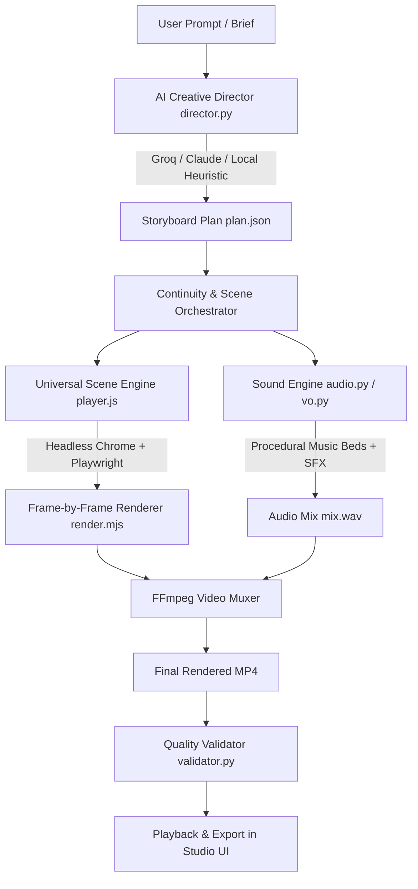

# Universal Animated Video Generator 🎬✨

An AI-powered creative animation studio that transforms arbitrary text prompts, stories, concepts, or scripts into fully animated, rendered, and audio-synchronized MP4 videos.

---

## 🌟 Highlights & Capabilities

- **Any Animation Genre**: Not limited to product marketing. Supports **Storytelling & Entertainment**, **Educational & Explainers**, **Cinematic & Creative Sequences**, **Social Media (Reels/TikTok/Shorts)**, and **Specialized Data & Technical Visualizations**.
- **Universal Scene Engine**:
  - `story`: Multi-layer animated environments (Martian canyons, deep space nebulae, enchanted forests, cyberpunk alleys), procedural atmospheric particles (dust, stars, embers, spores, fireflies), character animation (robots with glowing optic sensors, adventurers), and synchronized subtitle cards.
  - `motion`: High-end obsidian motion graphics powered by **NullMotion** GSAP templates and SVG charts (`16-line-growth`, `10-candlestick`, `13-compare-bars`, `06-notification`, `07-chat-sim`, `08-prompt-bar`, `27-cinematic-hud-overlay`).
  - `cinematic`: Anamorphic letterbox bars, chromatic lens flare sweeps, 3D perspective camera drift, and bold typography.
  - `whiteboard`: Animated hand-drawn diagrams, connecting arrows, concept nodes, and highlighter strokes.
  - `kinetic`: Fast-paced kinetic typography with scale pop and keyword accent pills.
  - `ui`, `cards`, `terminal`, `chips`, `text`, `hero`, `logo`: Full backward compatibility for SaaS demos and product videos.
- **Universal Sound Engine (`audio.py`)**:
  - Algorithmic DSP music bed generator supporting multiple moods: `cinematic` (lush ambient strings & sub drone), `lofi` (mellow electric piano), `suspense` (tense dark drone & pulse), `synthwave`, `playful`, `corporate`, or `silent`.
  - Rich procedural SFX kit: `whoosh`, `swish`, `riser`, `boom`, `pop`, `ding`, `ping`, `sparkle`, `laser`, `impact`, `glitch`, `shimmer`.
- **Character & Visual Continuity**: Tracks characters, environments, lighting, and color palettes across scenes for coherent story progression.
- **Interactive Web Studio UI (`studio/`)**: Visual creative brief, prompt preset library, interactive storyboard editor, SSE real-time render stream, integrated video player, and Quality Validation dashboard.
- **Automated Quality Validation (`validator.py`)**: Verifies video codecs (H.264), audio channels (AAC), duration adherence, frame rates, and detects unintended black frames.

---

## 🚀 Quick Start

### 1. Launch the Visual Studio (Browser UI)

```bash
npm start
# Or: node studio/server.mjs
```
Open **`http://127.0.0.1:4350`** in your browser.

- Type any prompt (e.g., *"A 45-second animated story about a lonely robot discovering a garden on Mars"*).
- Click **Plan Storyboard** to generate the scene sequence.
- Edit scene durations, visual directions, or reorder cards.
- Click **Render Video** to watch live progress and stream the finished video!

### 2. Run from the Command Line (CLI)

Generate and render an animated video end-to-end:

```bash
# Storytelling Narrative
python animate.py "A lonely robot discovering a garden on Mars" --duration 45 --style cinematic

# Educational Whiteboard Explainer
python animate.py "Explain quantum superposition and entanglement" --category educational --style whiteboard --duration 30

# Social Media Kinetic Reel (9:16)
python animate.py "Stop scrolling. 3 daily habits to double your focus" --category social --format 9:16 --duration 15

# Specialized Financial / Data Visualization
python animate.py "Cryptocurrency market shift and trading volume comparison" --category specialized --style motion_graphics --duration 20
```

---

## 🛠 Architecture & Pipeline



---

## 🧪 Running Automated Tests

Run the test suite verifying prompt understanding, category detection, continuity tracking, audio DSP synthesis, and validation:

```bash
python test/test_generator.py
```

---

## 🔑 Environment & Credentials

API keys are optional. If no keys are set, the built-in **Deterministic Local Heuristic Director** plans storyboards with zero network latency.

To connect external LLMs or cloud voice providers, configure `.env`:
```bash
GROQ_API=gsk_...           # Ultra-fast story planning via Llama 3.3 70B
ANTHROPIC_API=sk-ant-...   # Story planning via Claude 3.5 Sonnet
ELEVENLABS_API_KEY=sk_...  # High-fidelity neural voiceover
FISH_API_KEY=sk-fish-...   # Fish Audio voices
AUPHONIC_API_KEY=...       # Audio voice mastering
```
